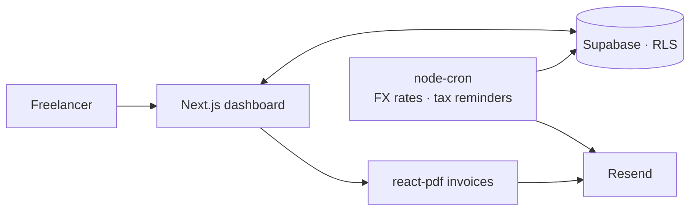

<div align="center">


<p>
  
  
  
  
</p>

<p><em>A minimalist, premium finance tool for freelancers and small businesses:<br>
invoices, irregular income, project profitability, tax reminders and multiple currencies.</em></p>

</div>


## Features

| | |
|---|---|
| **Invoices** | PDF generation, email delivery and status tracking (draft, sent, paid). |
| **Income and expenses** | Categorised transactions, recurring entries and receipt uploads. |
| **Dashboard** | A live income summary, project profitability and a currency widget. |
| **Clients** | Profiles with invoice history. |
| **Projects** | Profitability per project, budget versus actual. |
| **Tax calendar** | Turkish, US and German deadlines with reminders 7, 3 and 1 day before. |
| **Currencies** | Daily exchange rates with USD-based multi-currency support. |
| **Export** | Excel-friendly CSV with BOM. |
| **Command palette** | <kbd>⌘</kbd> <kbd>K</kbd> navigation. |
| **Onboarding** | A four-step setup that seeds tax dates for your country. |
| **TR / EN** | Turkish by default, English available; Google sign-in. |




## Türkçe özet

**Freelora**, serbest çalışanlar ve küçük işletmeler için sade ve şık bir finans yönetim aracı. Fatura oluşturup PDF olarak gönderme, gelir-gider takibi, proje bazlı kârlılık, Türkiye/ABD/Almanya vergi takvimi ve hatırlatmaları, günlük döviz kurlarıyla çoklu para birimi desteği sunuyor. Arayüz varsayılan olarak Türkçe; Supabase ve Google ile giriş yapılıyor.


## Development

```sh
npm install
cp .env.example .env.local   # Supabase, Resend, FX provider
npm run dev                  # http://localhost:3000
npm run cron                 # FX rates and tax reminders
npm run type-check
```

A Docker setup is included in `docker/` for self-hosting.

<div align="center">
<br>
<a href="https://github.com/kutluhangil"></a>
<sub>Irregular income, regular clarity.</sub>
</div>
