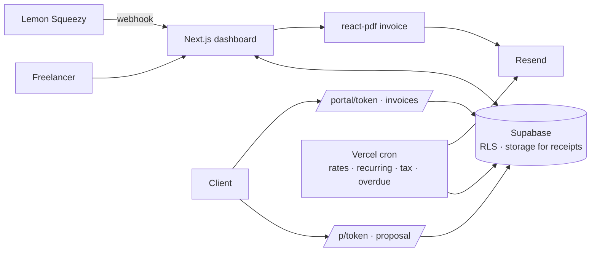

<div align="center">



<p>
  
  
  
  
</p>

<p><em>Finance for freelancers and small studios: invoices, proposals, income and expenses,<br>
time tracking and tax deadlines, in one calm dashboard that speaks Turkish first.</em></p>

</div>


## The idea

Freelance income is irregular, paid in several currencies, and comes with tax dates that do not care how busy you were. Freelora puts the whole loop in one place: send a proposal, turn the accepted work into an invoice, track the hours, log what you spend, and see the month in your own currency with the next deadline already on the calendar.

> **Your clients get a door, not a login.** A proposal is a private link the client can accept, and each client has a portal link that lists their invoices and statuses. No account on their side.


## Features

| | |
|---|---|
| **Invoices** | Line items, taxes and currency; PDF generated with `@react-pdf/renderer`; email delivery through Resend; statuses draft, sent, paid, overdue and cancelled. |
| **Recurring invoices** | Monthly, quarterly or yearly; a nightly job creates the next one. |
| **Overdue reminders** | A daily job emails the client once when an invoice passes its due date. |
| **Proposals** | Write a proposal and share a public `/p/[token]` link where the client can accept it. |
| **Client portal** | A `/portal/[token]` page per client with their invoices and statuses. |
| **Income and expenses** | Categorised transactions, recurring entries and receipt uploads to storage. |
| **Time tracker** | Start and stop timers per project and keep a log of entries. |
| **Projects and clients** | Profitability per project and every client's invoice history. |
| **Dashboard and reports** | Net for the month, income against expenses, project profitability and a currency widget. |
| **Tax calendar** | Turkish dates (KDV, muhtasar, geçici vergi, gelir vergisi, SGK, Bağ-Kur) and US quarterly estimates, seeded at onboarding, with email reminders 7, 3 and 1 day before. |
| **Currencies** | Daily USD-based exchange rates; every amount can be shown in your base currency. |
| **Export** | CSV with a BOM, so Excel opens Turkish characters correctly. |
| **Command palette** | <kbd>⌘</kbd> <kbd>K</kbd> to jump anywhere. |
| **Onboarding** | Four steps: welcome, profile, currency and taxes. |
| **Plans** | Free, Basic and Pro through Lemon Squeezy, priced in lira and dollars. |
| **TR / EN** | Turkish by default, English available; email and Google sign-in. |


## The nightly jobs

Four Vercel cron jobs run every morning (UTC):

| When | Job | Does |
|---|---|---|
| `06:00` | `/api/cron/exchange-sync` | Fetches the day's USD-based rates |
| `07:00` | `/api/cron/recurring-invoices` | Creates the invoices that are due to recur |
| `08:00` | `/api/cron/tax-reminders` | Emails deadlines 7, 3 and 1 day out |
| `09:00` | `/api/cron/overdue-reminders` | Emails clients about invoices past due, once each |

`npm run cron` runs the same schedule with `node-cron` when self-hosting.


## How it fits together



| Plan | Projects | Clients | Invoices / month | Price |
|---|---|---|---|---|
| Free | 2 | 3 | 3 | free |
| Basic | 10 | 20 | 20 | ₺249 or $14 a month |
| Pro | unlimited | unlimited | unlimited | ₺699 or $39 a month |


## Pages

| Route | Page |
|---|---|
| `/[locale]` · `/pricing` | Landing and plans |
| `/login` · `/register` · `/forgot-password` | Auth |
| `/dashboard` · `/reports` | Overview and reports |
| `/invoices` · `/invoices/new` · `/invoices/[id]` | Invoices |
| `/proposals` | Proposals |
| `/income` · `/expenses` | Money in and out |
| `/projects` · `/clients` | Work and people |
| `/time-tracker` · `/calendar` · `/currency` | Hours, deadlines, rates |
| `/settings` · `/settings/profile` · `/settings/billing` | Account and plan |
| `/p/[token]` · `/portal/[token]` | What the client sees |


## Türkçe özet

**Freelora**, serbest çalışanlar ve küçük stüdyolar için bir finans yönetim aracı. Teklif hazırlayıp bağlantıyla gönderme, PDF fatura ve e-posta, tekrarlayan faturalar, gecikme hatırlatmaları, gelir-gider ve fiş yükleme, proje bazlı zaman takibi ve kârlılık var. Türkiye vergi takvimi (KDV, muhtasar, geçici vergi, gelir vergisi, SGK, Bağ-Kur) ve ABD üç aylık tahminleri 7, 3 ve 1 gün önceden hatırlatılıyor. Müşteri hesap açmadan teklifi kabul ediyor ve kendi portalından faturalarını görüyor. Arayüz varsayılan olarak Türkçe.


## Development

```sh
npm install
cp .env.example .env.local
npm run dev            # http://localhost:3000
npm run cron           # the four jobs with node-cron
npm run type-check
npm run build
```

`.env.local` takes `NEXT_PUBLIC_SUPABASE_URL`, `NEXT_PUBLIC_SUPABASE_ANON_KEY`, `SUPABASE_SERVICE_ROLE_KEY`, `RESEND_API_KEY`, `RESEND_FROM_EMAIL`, `EXCHANGE_RATE_API_KEY`, `NEXT_PUBLIC_APP_URL`, `CRON_SECRET`, and for billing `LEMON_SQUEEZY_API_KEY`, `LEMON_SQUEEZY_WEBHOOK_SECRET`, `NEXT_PUBLIC_LEMON_SQUEEZY_STORE_ID` and the `NEXT_PUBLIC_LS_*` variant ids. `DOMAIN` and `SSL_EMAIL` are for the Docker setup; `SETUP_GUIDE.md` and `VERCEL_DEPLOY.md` walk through both.

```
src/app/[locale]/     landing, auth, dashboard pages, proposal and portal pages
src/app/api/          invoices (PDF, email), exchange rates, cron jobs, Lemon Squeezy webhook
src/components/       invoices, clients, projects, onboarding, command palette
src/lib/constants/    plans, currencies, categories, tax dates
supabase/migrations/  13 migrations: schema, RLS, triggers, time entries, proposals, portal, recurring
docker/               self-hosting setup
```

<div align="center">
<br>
<a href="https://github.com/kutluhangil"></a>
<sub>MIT licensed · irregular income, regular clarity · clients and amounts in the banner are invented.</sub>
</div>
